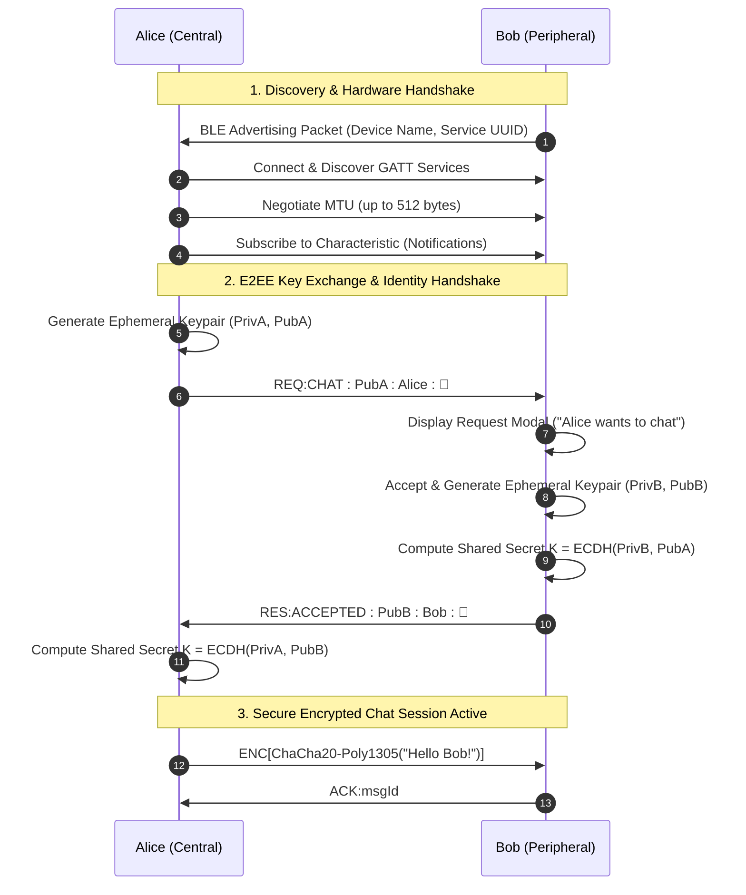

# 📡 AirChat — Offline Peer-to-Peer Encrypted Messenger

<p align="center">
  
</p>

<p align="center">
  <b>True Off-Grid Communication. Zero Internet. Zero Servers. Zero Tracking.</b><br />
  Pure Bluetooth Low Energy (BLE) peer-to-peer messaging with military-grade End-to-End Encryption (E2EE).
</p>

<p align="center">
  
  
  
  
  
</p>

---

## 📥 Download the Latest APK

You can download the pre-compiled Android APK directly from GitHub Releases:

<p align="center">
  <a href="https://github.com/Himangshuroy101/AirChat/releases/download/v1.0.0/app-release.apk">
    
  </a>
</p>

> You can also browse all versions on the [**GitHub Releases Page**](https://github.com/Himangshuroy101/AirChat/releases).

---

## 🌟 Why AirChat?

Most modern messaging applications depend heavily on centralized servers, cell towers, Wi-Fi networks, and user phone numbers. When disasters strike, during outdoor expeditions, in crowded stadiums, or in subway tunnels, standard communications fail completely.

**AirChat turns your phone into an independent radio transceiver.** By utilizing simultaneous Bluetooth Low Energy (BLE) Central & Peripheral dualities, two devices can discover each other, negotiate keys, and communicate privately up to 30–50 meters away with zero internet connection or cellular signal.

---

## ✨ Features

- 📶 **100% Offline & Serverless**: No internet, cell tower, SIM card, or central server required. Operates purely through peer-to-peer Bluetooth radio.
- 🔒 **End-to-End Encryption (E2EE)**:
  - **Curve25519 (X25519)** Diffie-Hellman key exchange for ephemeral shared secret agreement.
  - **ChaCha20-Poly1305** 256-bit Authenticated Encryption with Associated Data (AEAD) ensuring tamper-proof confidentiality and authentication.
- 🤝 **Interactive Handshake with Identity**:
  - Request/Accept handshake displays the partner's chosen name and avatar before entering the chat.
  - Prevents unsolicited messaging and connection hijackings.
- ⚡ **Live Real-Time Indicators**:
  - Peer online/reconnection status dot in the header.
  - Over-the-air typing indicators (`✏️ typing...`).
  - Message status receipts (`✓` sent, `✓✓` delivered).
- 💥 **Bump to Connect**:
  - Accelerometer-powered physics gesture: gently bump or shake phones together to immediately connect to the closest peer.
- 📍 **Offline Quick Share**:
  - Send vCard contact details.
  - Send live offline GPS coordinates.
  - Tap-to-send emergency and quick replies.
- 🧩 **Robust Packet Transport**:
  - Automatic MTU negotiation (up to 512 bytes on modern Android).
  - High-speed packet chunking & reassembly pipeline (`C:<id>:<seq>:<total>:<payload>`).
  - Automatic duplicate beacon filtering for Android Resolvable Private Addresses (RPA).
- 🚪 **Clean Disconnect Protocol**:
  - Instant `SYS:DISCONNECT` broadcast preventing ghost sessions and redundant connection lost alerts.

---

## 🏗️ Architecture & Communication Flow



---

## 📱 How to Install the APK on Android

1. Download `AirChat.apk` on your Android device from the [Releases](https://github.com/Himangshuroy101/AirChat/releases) page.

2. Tap the downloaded file in your Notifications or Downloads folder.
3. If prompted by Android:
   - Select **Settings** -> **Allow from this source** (or "Install Unknown Apps").
4. Tap **Install** and then **Open**.
5. **Permissions Required**:
   - **Nearby Devices / Bluetooth**: To scan, advertise, and connect over BLE.
   - **Location (GPS)**: Required by the Android OS to scan for nearby Bluetooth LE peripherals. *AirChat does not track or upload your location anywhere.*

---

## 🛠️ Building & Running From Source

### Prerequisites
- [Node.js](https://nodejs.org/) (v18.x or v20.x recommended)
- [Java Development Kit (JDK 17)](https://www.oracle.com/java/technologies/javase/jdk17-archive-downloads.html)
- [Android Studio](https://developer.android.com/studio) with Android SDK platform 35/36 installed
- Physical Android phone with Bluetooth 4.2+ (BLE simulation does not run in Android Studio emulators)

### Step 1: Clone Repository
```bash
git clone https://github.com/Himangshuroy101/AirChat.git
cd AirChat
```

### Step 2: Install Dependencies
```bash
npm install
```
> *Note: `npm install` automatically triggers `patch-package`, applying critical native BLE fixes to `react-native-ble-plx` and `react-native-ble-peripheral`.*

### Step 3: Run Development Build
Connect your physical Android device via USB with USB Debugging enabled:
```bash
npx expo run:android
```

### Step 4: Build Standalone APK
To generate a release APK locally using Gradle:
```bash
cd android
./gradlew assembleRelease
```
The compiled APK will be created at:
```
android/app/build/outputs/apk/release/app-release.apk
```
*(Or use `assembleDebug` to build `android/app/build/outputs/apk/debug/app-debug.apk`)*

---

## 🔐 Cryptography Specifications

| Component | Specification |
|---|---|
| **Asymmetric Key Agreement** | Curve25519 (X25519 ECDH) |
| **Symmetric Encryption** | ChaCha20 Stream Cipher |
| **Authentication & Integrity** | Poly1305 MAC (128-bit Authentication Tag) |
| **Key Lifespan** | Ephemeral per-session keys (destroyed upon disconnect) |
| **Storage Security** | Chat history is stored locally in sandbox async storage; zero telemetry |

---

## 🤝 Contributing

Contributions, issues, and feature requests are welcome!
Feel free to open an issue or submit a Pull Request.

---

## 📄 License

This project is licensed under the MIT License — see the [LICENSE](LICENSE) file for details.

